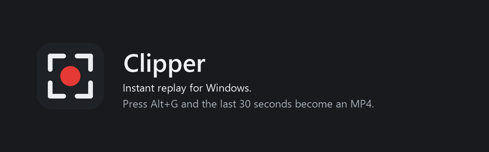
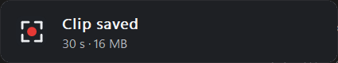
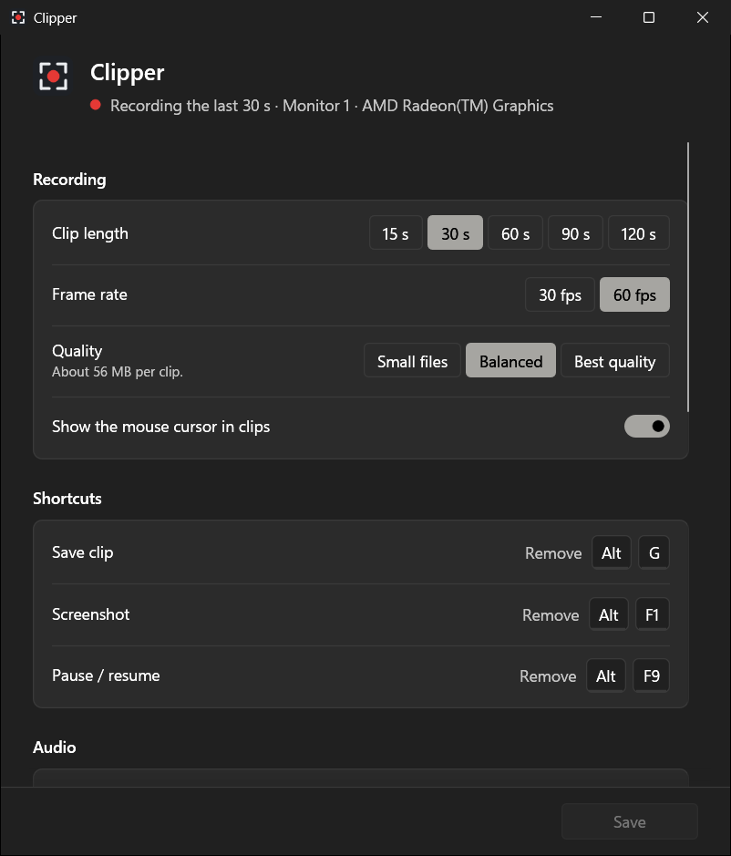
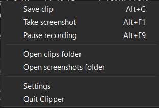

<p align="center"></p>

# Clipper

Clipper keeps the last 30 seconds of your game and its sound, and saves them as an MP4 when you press **Alt+G**. **Alt+F1** takes a screenshot. It sits next to the clock and stays out of your way: about 40 to 50 MB of memory in Task Manager and under 1% CPU while it records.

It is a small replacement for the Xbox Game Bar's "record what happened": one 4 MB program, no account, no overlay, no background services.

## What you get

- **Records your games, not your desktop.** Clipper finds the games installed from Steam, Epic, Riot, GOG, Ubisoft, EA and the Xbox app, plus every game Windows itself has recognized, and records the game's own window. Switch to a browser or Discord with Alt+Tab and the clip still shows the game. With no game open, nothing is recorded and the GPU stays idle.
- **Desktop recording when you want it.** Turn it on in settings and Clipper records the screen whenever no game is open, then goes back to the game when one starts.
- **Missing a game?** Add its program in settings and Clipper always treats it as one: a standalone download, an itch.io game, a private server.
- **Save the last 15 to 120 seconds** with one shortcut, whenever something worth keeping just happened. Clips go to `Videos\Captures`, the same folder Windows uses.
- **Screenshots** of whatever the monitor you are using shows, saved as PNG next to your clips.
- **Works over full-screen games.** Clips and screenshots capture borderless and exclusive full-screen games, and a game that changes the screen resolution keeps its picture in the clip.
- **A quiet confirmation.** A small card shows "Clip saved" in the corner for two seconds. The mouse goes straight through it and the game keeps focus.
- **Game sound and your microphone** in one track, in sync with the picture. Pick any output and input in settings, or leave both on the Windows default and Clipper follows it.
- **Follows you across monitors.** Screenshots and desktop recording use the screen that holds the focused window.
- **Your choice of quality:** three presets, or a bitrate of your own in kbps. The bitrate is a target, not a fixed rate: busy scenes use it, still ones use far less.
- **Light on laptops with two graphics chips.** Clipper records with the power-saving GPU, so a dedicated card can stay asleep on the desktop.
- **Runs on any Windows PC.** It uses the GPU's video encoder when there is one, and falls back to software encoding at 30 fps when there is not.
- **Clips play everywhere:** H.264 and AAC in a standard MP4, ready for Discord, browsers and phones.

<p align="center"></p>

## Install

1. Download `clipper.exe` from the [releases page](../../releases) and put it anywhere, for example `%LOCALAPPDATA%\Clipper`.
2. Run it. A record icon appears next to the clock and recording starts.
3. Right-click the icon for the menu, or left-click it for settings.

Clipper starts with Windows unless you turn that off in settings. To uninstall, choose **Quit Clipper** from the menu, delete the file, and optionally delete `%APPDATA%\Clipper` (settings and log).

## Shortcuts

| Action | Default |
| --- | --- |
| Save the last 30 seconds | `Alt+G` |
| Screenshot | `Alt+F1` |
| Pause or resume recording | `Alt+F9` |

Change them in settings: click a shortcut and press the new keys. If another app already uses a combination, Clipper still receives it.

## Settings

<p align="center">&nbsp;&nbsp;</p>

Clip length, frame rate (30 or 60 fps), quality or a custom bitrate, shortcuts, audio devices, games you added, desktop recording, which monitor to use when no window has focus, and where files go. Changes apply as soon as you save, without restarting. Settings run in a separate window process that exits when you close it.

## Where things go

| What | Location |
| --- | --- |
| Clips and screenshots | `Videos\Captures` (each can be changed) |
| Settings | `%APPDATA%\Clipper\config.ini` (plain text) |
| Log | `%APPDATA%\Clipper\clipper.log` |
| Replay buffer | `%TEMP%\Clipper`, about 40 seconds of video in 10-second files, rewritten as it records |

## Resource use

Measured on a laptop with an AMD Radeon integrated GPU and an NVIDIA RTX 3050, recording a 1920×1080 monitor at 60 fps:

| | Measured |
| --- | --- |
| Memory (Task Manager) | 36 to 48 MB |
| CPU | under 1% |
| GPU video encoder, while the screen changes | about 15% of the integrated GPU's encoder |
| GPU video encoder, on a still screen | nothing: a still screen produces no new frames |
| Dedicated NVIDIA card on the desktop | stays in its idle power state, about 5 W |

The video encoder is a separate part of the GPU from the one games draw with. At 30 fps it does half the work.

## Requirements

- Windows 10 version 2004 or later, or Windows 11.
- Any GPU. Hardware encoding is tested on AMD (VCN) and NVIDIA (NVENC). Intel Quick Sync uses the same Windows encoder interface but has not been tested yet. Without a hardware encoder, Clipper records at 30 fps on the CPU and uses more memory.

## How it works

- **Finding games:** the install folders of Steam (every library), Epic, Riot, GOG, Ubisoft, EA and the Xbox app, read again every minute, plus the list of games Windows keeps for the Game Bar. A program that fills its whole monitor while in front also counts. Launchers, browsers and chat apps never do. Nothing is injected into the game.
- **Capture:** Windows.Graphics.Capture of the game's window (or a monitor for desktop recording) on a Direct3D 11 device, so frames stay on the GPU.
- **Encoding:** the GPU's H.264 encoder through Media Foundation, or NVIDIA's NVENC directly on NVIDIA cards. Variable bitrate, a keyframe every second, low-latency mode. Audio is AAC.
- **Audio:** WASAPI loopback and microphone capture through [cpal](https://github.com/RustAudio/cpal), resampled to 48 kHz and mixed on the same clock as the video frames.
- **Replay buffer:** short MP4 segments on disk, so memory does not grow with clip length.
- **Saving:** a small built-in MP4 remuxer (`src/mp4.rs`) joins the segments without re-encoding. An edit list makes the clip start exactly at the requested second.
- **Settings window:** [egui](https://github.com/emilk/egui) drawn on the CPU, started as `clipper.exe --settings`, so no graphics driver is loaded for it.

## Build

Requires Rust 1.91 or newer with the MSVC toolchain, and the Windows SDK (for the resource compiler).

```powershell
cargo build --release
# target\release\clipper.exe
```

### Tests

```powershell
cargo test --release          # config parsing and the MP4 remuxer
pwsh tests/e2e.ps1            # records real clips on this PC and checks them
```

The end-to-end script needs `ffmpeg` and `ffprobe` on `PATH` for its measurements. It plays a test video full screen for about three minutes, so leave the PC alone while it runs. It checks clip length, frame rate, bitrate, audio and video sync, screenshots, pause and resume, live settings reload, memory and CPU.

`cargo run --release --example fullscreen_test` opens an exclusive full-screen window that changes the display resolution, for testing capture of older games.

## License

Clipper is free software under the [GNU General Public License v3.0 or later](LICENSE): you can use, study, change and share it, and anything you distribute that is built on it must stay open under the same license.
